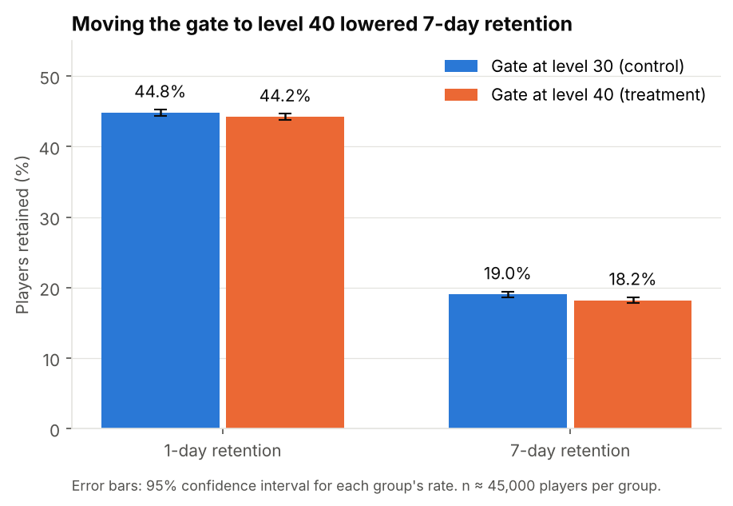

# A/B Testing Case Study: Gate Placement in a Mobile Game

**Should a mobile game move its first progress gate from level 30 to level 40?** This project analyzes a real A/B test on about 90,000 players of the puzzle game *Cookie Cats* and makes a ship / don't-ship recommendation.

**Recommendation: keep the gate at level 30.** Moving it to level 40 lowered 7-day retention by 0.82 percentage points (19.0% → 18.2%, p = 0.0016) with no offsetting gain in engagement.



## Results

| Metric | Gate at 30 (control) | Gate at 40 (treatment) | Difference | p-value | Significant? |
|---|---|---|---|---|---|
| **7-day retention** (primary) | 19.02% | 18.20% | **−0.82 pp** (95% CI −1.33 to −0.31) | 0.0016 | Yes |
| 1-day retention | 44.82% | 44.23% | −0.59 pp | 0.074 | No |
| Game rounds, first 14 days (median) | 17 | 16 | −1 round | 0.051 (Mann-Whitney) | No |

Significance threshold: α = 0.025 per retention metric (Bonferroni correction across the two retention metrics).

## What the analysis covers

1. **Experiment design.** Primary metric chosen up front (7-day retention), secondary metric, engagement check, and a multiple-testing correction.
2. **Data quality.** No missing values or duplicate players. One player logged 49,854 rounds in 14 days (about 17× the next-highest); removed as a likely bot or logging error, with a sensitivity check showing the result is unchanged either way.
3. **Sample ratio mismatch (SRM) check.** The groups are 49.6% / 50.4%, and a chi-square test flags this as unlikely under a 50/50 split (p = 0.009). The notebook explains what that could mean, why this dataset can't diagnose it, and why it doesn't change this particular decision.
4. **Power analysis.** The test could reliably detect changes of about 0.8 pp in 7-day retention, which frames how to read the non-significant results.
5. **Hypothesis tests.** Two-proportion z-tests for retention, confirmed with a 5,000-resample bootstrap; Mann-Whitney U test for the heavily skewed engagement metric.
6. **Recommendation, caveats, and next steps.**

## Key takeaways

- **The gate acts as a useful pause.** At level 30 it arrives early enough that players take a break and come back. Pushing it to level 40 doesn't increase early play; it just means fewer players return a week later.
- **Day 1 can hide day 7 effects.** 1-day retention showed no significant change, so a team watching only short-term metrics could have shipped this.
- **Check the experiment before trusting it.** The SRM is a real finding. If this analysis had pointed toward shipping a change, I would not recommend acting on it until the imbalance was explained.

## Repository structure

```
ab-testing-case-study/
├── data/
│   ├── cookie_cats.csv          # 90,189 players, one row each
│   └── README.md                # data source and column definitions
├── notebooks/
│   └── cookie_cats_ab_test.ipynb  # full analysis with outputs
├── src/
│   └── ab_stats.py              # SRM check, z-test, bootstrap, power/MDE
├── tests/
│   └── test_ab_stats.py         # unit tests for the stats functions
├── reports/figures/             # charts used in the notebook and README
└── requirements.txt
```

The statistical functions live in `src/ab_stats.py` rather than inline in the notebook, so they're reusable and tested. They use only NumPy and SciPy, which keeps each calculation easy to read.

## How to run

```bash
git clone https://github.com/kennethpangestu/ab-testing-case-study.git
cd ab-testing-case-study
python -m venv .venv && source .venv/bin/activate   # Windows: .venv\Scripts\activate
pip install -r requirements.txt

pytest                                  # run the unit tests
jupyter lab notebooks/cookie_cats_ab_test.ipynb
```

## Limitations

- **Sample ratio mismatch.** The intended traffic split isn't documented; if it was 50/50, assignment or logging was uneven.
- **Short horizon.** Only 1-day and 7-day retention and 14-day rounds are available. Revenue and longer-term retention aren't observed, and a later gate could change purchase behavior.
- **Rounds aren't levels.** The data records rounds played, not level reached, so it can't show how many players actually hit each gate.

## Data

Cookie Cats A/B test data (Tactile Entertainment), originally released for a DataCamp project and widely used for teaching A/B testing. See [`data/README.md`](data/README.md).
